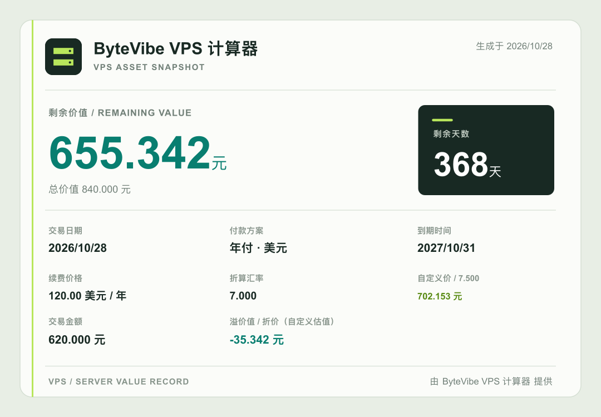

# VPS 剩余价值计算器

用于估算 VPS 在转移或出售时的剩余价值。输入续费价格、付款周期、到期日期和交易日期，即可查看剩余天数与折算价值；填写人民币成交金额后，还会显示相对估值的溢价或折价。

## 项目来源

本项目基于 [hahabye/vps_jsq](https://github.com/hahabye/vps_jsq) 二次开发。感谢原作者 hahabye 开源 VPS 剩余价值计算器及其早期实现。本仓库在原项目基础上继续维护，并增加 Go 服务端、Docker 部署、资产账单式页面、交易金额与溢价值计算、汇率服务端缓存，以及可直接分享的 SVG 资产快照。

项目遵循 [GPL-3.0](LICENSE.txt)。基于本项目修改或分发代码时，请遵守许可证要求，并保留原项目及本项目的版权和许可声明。

在线体验：[VPS 剩余价值计算器](https://tools.196000.xyz/jsq)

## 功能

- 按到期日、交易日和付款周期计算 VPS 剩余天数与剩余价值，按实际日历月长度折算。
- 支持多种续费货币和付款周期；外币按参考汇率折算成人民币，也可输入自定义汇率查看自定义估值。
- 可选填人民币成交金额，展示成交价相对剩余价值的溢价或折价；有不同的自定义汇率时，以自定义估值为比较基准。
- 生成包含站点图标、估值方式、续费方案和交易对比的 SVG 分享图。未配置站点图标时使用内置品牌图标。
- 桌面和移动浏览器均可使用。

## 分享图示例

以下示例包含自定义汇率、成交金额和折价结果：



## 部署

需要 Docker Engine 和 Docker Compose。在项目目录运行：

```sh
docker compose up -d --build
```

默认访问 `http://localhost:8088`。如需更换主机端口，可在启动时设置 `HOST_PORT`：

```sh
HOST_PORT=9000 docker compose up -d --build
```

查看日志或停止服务：

```sh
docker compose logs -f
docker compose down
```

页面和 API 由同一个 Go 服务提供，不需要单独构建前端。`dist/` 是历史静态发布产物，不参与当前 Docker 镜像构建。

## 配置

复制环境变量模板并按需修改：

```sh
cp .env.example .env
```

主要配置项：

| 变量 | 说明 |
| --- | --- |
| `HOST_PORT` | Docker 暴露到主机的端口，默认 `8088` |
| `RATE_PROVIDER` | 汇率来源：`frankfurter` 或 `exchangerate-api` |
| `EXCHANGERATE_API_KEY` | ExchangeRate-API 密钥，可留空使用其 Open Access 接口 |
| `RATES_URL` | 可选的兼容汇率接口地址覆盖项 |
| `SITE_NAME` | 页面和分享图中的站点名称 |
| `SITE_DESCRIPTION`、`SITE_KEYWORDS` | SEO 描述和关键词 |
| `SITE_URL` | 公网站点 origin，不带路径；用于 canonical 地址和分享链接 |
| `SITE_ICON_URL` | HTTP(S) 图标地址或站点内绝对路径；留空时使用内置品牌图标 |

默认汇率来源为 Frankfurter。服务端会请求并缓存汇率 24 小时；如选择其他数据来源，请遵守其使用条款。Frankfurter 的数据许可见[官方说明](https://frankfurter.dev/license/)。

## API 与分享链接

- `POST /api/v1/calculate`：计算剩余价值并返回分享链接。
- `GET /api/v1/rates`：获取当前汇率。
- `GET /share/<id>.svg`：访问计算结果 SVG 分享图。

旧路径 `/api/vps/jsq`、`/api/vps/rates` 和 `/uploads/images/jsq/<id>.svg` 仍保留兼容。计算金额由 Go 服务端完成；分享链接包含计算所需的结果参数，可独立呈现快照。

## 本地运行

需要 Go 1.23 或更新版本：

```sh
go run .
```

默认访问 `http://localhost:8080`。运行测试：

```sh
go test ./...
```


## 问题与建议

遇到问题或有功能建议，欢迎在 [ByteVibe Gitea Issues](https://git.bytevibe.dev/gary/vps_jsq/issues) 提交 Issue。
